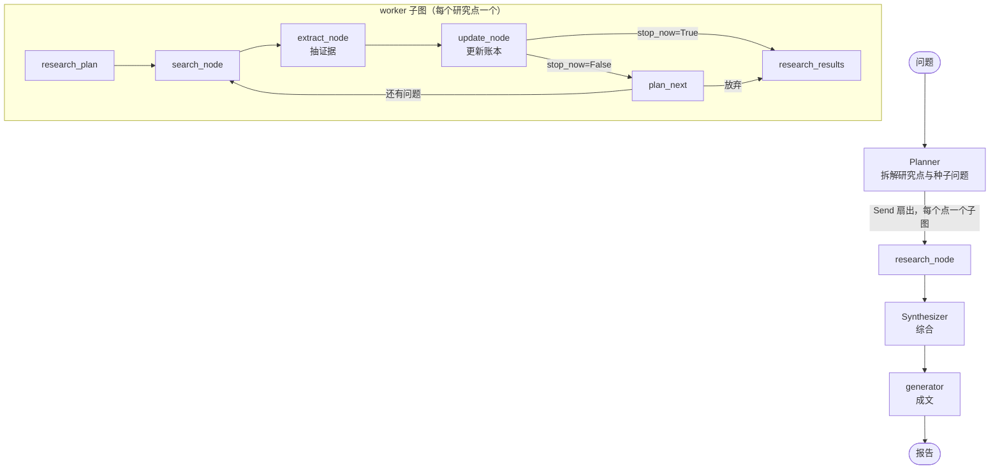

# research-agent · 可溯源的多智能体研究系统

> 一个以「重要结论必须能追到原文」为硬约束的多智能体系统：允许有没查清楚的问题，但不允许编造。
> LangGraph 双层图 + 代码持有的证据账本 + 逐条引用校验。

- Python 3.13 / LangGraph 1.x / FastAPI / PostgreSQL
- 双层图：主图规划与综合，worker 子图执行检索闭环
- 每条结论校验：来源真实存在、引文能在原文定位、结论中的数字与术语必须出现在引文里
- 循环终止由代码裁决，不由模型自行决定

---

## 这个项目在解决什么问题

通用研究 Agent 的失败模式很固定：**它总能给你一份看起来很完整的报告**。问题在于你无法判断哪一句有据、哪一句是编的。

所以这个项目的目标不是"写出更好的报告"，而是：

> **保证重要结论一定有真实来源。可以允许有没查清楚的问题，但不能乱说。**

这条约束反过来决定了几乎所有设计——证据要落账本、引用要能校验、循环不能靠模型自省停下。

---

## 核心设计

### 1. 双层图：规划扇出 + 检索闭环



主图只做两件事：拆问题、汇编结果。所有"脏活"（检索、抽取、判断）都在子图里，每个研究点独立跑，互不影响。

### 2. 账本由代码持有，模型只能追加

`ResearchWorkerState` 里三本账只增不改：

| 账本 | 内容 | 谁写 |
|---|---|---|
| `points` | 研究点及状态（待查 / 已查清 / 放弃） | `update_node` 按校验结果写 |
| `findings` | 累计证据（claim + quote + source） | 只追加，不覆盖 |
| `sources` | 累计来源表 | **只有 `search_node` 是写者** |

关键点：**模型不负责"记住"，只负责"往里加"。** 上下文被截断、被压缩、被重排，账本都不会丢——因为它不在 prompt 里，在 state 里。

### 3. 终止裁决不交给模型

```python
def route_after_update(state) -> Literal["plan_next", "research_results"]:
    """只读 stop_now（由 update_node 根据 should_stop 写入），
    不读任何 LLM 产出字段——避免模型"自己决定停"。"""
    return "research_results" if state.get("stop_now") else "plan_next"
```

`stop_reason` 是枚举：`all_done` / `no_progress` / `max_rounds` / `errors`。

为什么这么做：让模型自己判断"查够了吗"，它要么早停（漏查），要么无限查（烧钱、超时）。所以判据放在代码里——连续无新证据、检索预算耗尽、轮数超限，一命中就收尾。

### 4. 逐条引用校验

`validators/findings.py` 在证据入账前做三道检查：

1. `source_id` 必须存在于 `sources` 账本
2. `quote` 必须能在原文中定位到
3. claim 里的**数字、英文术语、代码标识符**必须出现在 quote 内

不合格的 finding 直接丢弃，不进账本——**宁可少一条结论，不留一条无据的结论**。

### 5. 把"判断"拆成三个节点

`extract_node` / `update_node` / `plan_next` 各管一件事：

- `extract`：从本轮新来源里抽证据
- `update`：合并进账本、算是否有进展、写 `stop_now`
- `plan_next`：决定下一轮问什么

拆开的原因是单节点职责过重会导致两个问题：上下文过长（超时）、一次调用里同时做抽取和决策（质量下降）。跨轮累积放在 state 里，不放在 prompt 里。

### 6. 可中断、可续跑

`AsyncPostgresSaver` 做 checkpoint，run 落在 Postgres：

- `POST /research/{id}/cancel` 取消
- `POST /research/{id}/resume` 从断点续跑
- `GET /research/{id}/stream` SSE 推送节点事件

---

## 接口

| 方法 | 路径 | 说明 |
|---|---|---|
| POST | `/research/` | 提交研究问题，返回 `run_id`（202） |
| GET | `/research/{run_id}` | 查询状态、计划、中间结果、报告 |
| GET | `/research/{run_id}/stream` | SSE 事件流 |
| POST | `/research/{run_id}/cancel` | 取消 |
| POST | `/research/{run_id}/resume` | 断点续跑 |

---

## 快速开始

```bash
uv sync

# .env 需要两项：
#   api_key  —— 模型服务密钥（当前走 OpenAI 兼容接口）
#   db_uri   —— PostgreSQL 连接串，用于 checkpointer
# 检索服务的 key 见 src/research_agent/graph/tools.py

uv run uvicorn research_agent.main:app --reload
```

服务启动时初始化 checkpointer 表结构，agent 编译后挂在 `app.state` 上。

---

## 已知限制

诚实记录，避免误读：

1. **没有自动化测试**——`validators/` 全是纯函数，是最容易补的一层
2. **没有评测集**——目前只有设计约束，没有"引用校验把幻觉降低了多少"的数字
3. **没有成本记录**——token 与费用未落库，无法按节点核算，也不知道哪个节点最贵
4. **SSE 用进程内队列**——`run_queues` 是模块级字典，多 worker 部署会失效（订阅方连到别的进程收不到事件），进程重启后流丢失
5. **无鉴权**——接口默认对内网开放，生产部署需要前置网关
6. **CORS 为通配符 + credentials**——浏览器会拒绝，本地调试无影响
7. **Synthesizer 上下文过长会超时**——所有子结果一次性塞进综合节点，已知问题，计划改 map-reduce
8. **单实例部署**

---

## Roadmap

- [ ] 20 条评测集，输出通过率 / 单次成本 / P95 延迟三个数字
- [ ] state 累积 token 与节点耗时，每次 run 落一份 metrics
- [ ] SSE 改为事件落库 + `from_seq` 回放，支持多 worker
- [ ] `validators/` 单元测试（纯函数，成本最低）
- [ ] CI（lint + 单测）
- [ ] Synthesizer 改 map-reduce + 流式收尾

---

## 目录结构

```
src/research_agent/
├── main.py              # FastAPI 入口，lifespan 里初始化 checkpointer
├── config.py            # 配置（模型 key、数据库）
├── llm.py               # 模型实例
├── api/research.py      # 提交 / 查询 / SSE / 取消 / 续跑
├── services/            # run 编排：启动、状态快照、续跑
├── schemas/research.py  # Plan / Task / Point / Source / Finding / Report
├── graph/
│   ├── state.py         # 主图与子图的 State（含三本账）
│   ├── main_workflow.py # 主图：Planner → 扇出 → Synthesizer → generator
│   ├── worker_workflow.py # 子图：plan → search → extract → update → plan_next
│   ├── main_nodes.py    # 主图节点
│   ├── worker_nodes.py  # 子图节点
│   ├── *_prompt.py      # 各节点 prompt
│   ├── tools.py         # 检索工具
│   └── render.py        # 报告渲染
└── validators/
    ├── findings.py      # 引用与 claim 校验（核心约束）
    ├── points.py        # should_stop 判据
    ├── sources.py       # 来源校验
    └── report.py        # 报告校验
```
